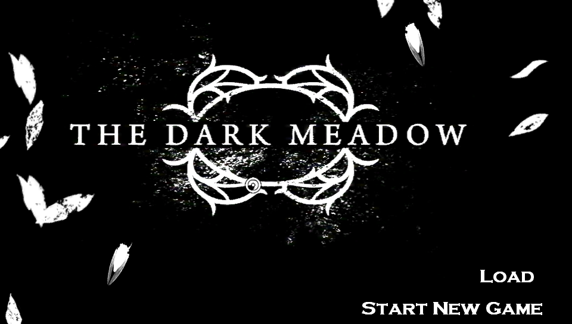
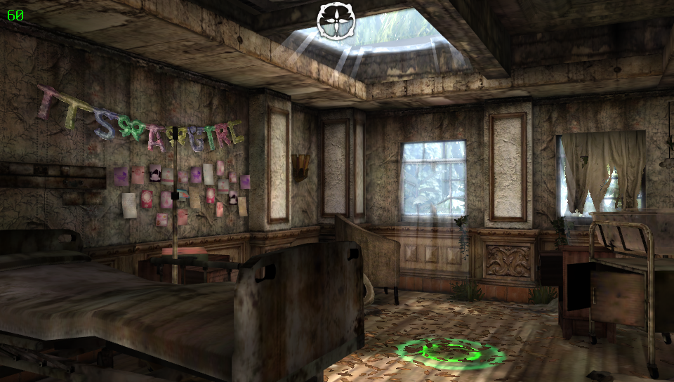
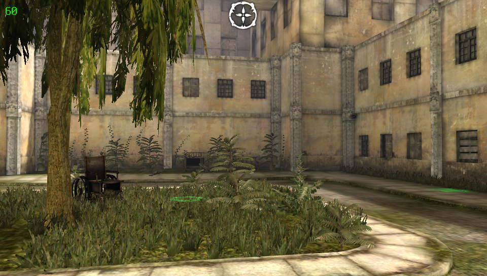
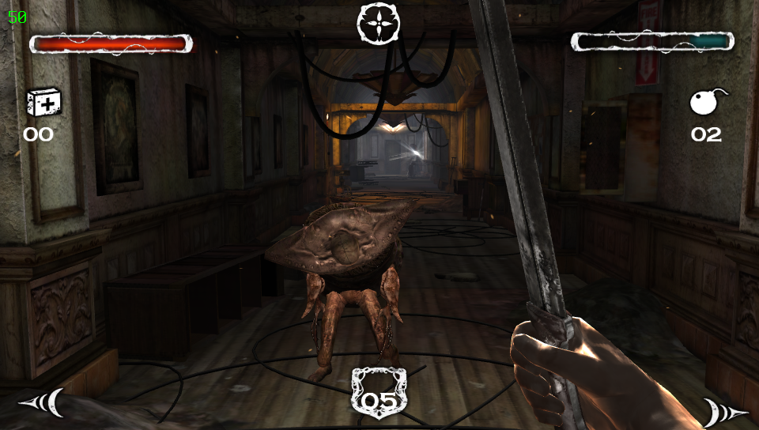

# Dark Meadow: The Pact - PS Vita

A loader that runs the Android version of *Dark Meadow: The Pact* on the PS Vita. It loads the game's own engine
library and provides what it expects from Android: graphics through vitaGL, sound, music and movies, touch, and
physical controls.

**The game is not included.** You need your own copy of the Android version, 1.4.6.4 PowerVR (version code 69).

<p align="center">
  
  
  
  
</p>


## Required files

On the Vita:

* **HENkaku/Ensō** with **kubridge** (a recent version: the loader needs `kuKernelMemProtect`). Install
  `kubridge.skprx` into `ur0:tai/`, add it under `*KERNEL` in `ur0:tai/config.txt` and reboot.

From the game, all into `ux0:data/darkmeadow/`:

| File | Where it comes from |
|---|---|
| `libUnrealEngine3.so` | the APK (a zip): `lib/armeabi-v7a/libUnrealEngine3.so` |
| `main.69.com.phosphorgames.DarkMeadow.obb` | the game's expansion file |
| `patch.69.com.phosphorgames.DarkMeadow.obb` | the game's expansion file |
| `movies/*.mp4` | optional, see [Movies](#movies) |

Leave the `.obb` files as they are.

## Building

You need **VitaSDK-softfp** (the soft-float VitaSDK; the game's library is soft-float code), `cmake` 3.16 or newer
and `make`. On Windows use WSL.

1. Set up the SDK:
   ```sh
   export VITASDK=/usr/local/vitasdk-softfp      # where you installed it
   export PATH="$VITASDK/bin:$PATH"
   ```
2. Make sure it has these libraries (install missing ones with `vdpm`): mpg123, zlib, vitashark, SceShaccCgExt,
   mathneon.
3. Install a current kubridge into the SDK:
   ```sh
   git clone https://github.com/bythos14/kubridge
   cd kubridge && cmake -B build && cmake --build build && cmake --install build
   ```
4. Build:
   ```sh
   cmake -S . -B build -DCMAKE_BUILD_TYPE=Release
   cmake --build build -j4
   ```
   The result is `build/DarkMeadow.vpk`. Install it with VitaShell.

Build types: `Release` (optimised, logs errors only), `Profile` (just as optimised, and writes a full log: use it
when reporting a problem), `Debug` (slow, full logging). Delete the build folder after changing `VITASDK` or the build
type.

| Error | Fix |
|---|---|
| `Please define VITASDK env var` | set `VITASDK` (step 1) |
| `cannot find -lXYZ` | install the library that provides `libXYZ.a` (step 2) |
| `uses VFP register arguments` | you are using the hard-float SDK; use VitaSDK-softfp |
| `kuKernelMemProtect` undeclared | kubridge in the SDK is too old (step 3) |

## Movies

The game's movies are in a format the Vita cannot decode. Convert them once on a PC with `ffmpeg` (with libx264):

```sh
mkdir m4v && cd m4v
unzip -j ../main.69.com.phosphorgames.DarkMeadow.obb 'UDKGame/Movies/*.m4v'
cd .. && tools/convert_movies.sh m4v movies
```

Copy `movies/*.mp4` to `ux0:data/darkmeadow/movies/`. Without them the game runs normally and skips its movies.

## Shader cache (optional)

The first time each effect appears, its shaders are compiled on the Vita, which causes short stutters on a first
playthrough. The releases include `shader_cache.zip`, a cache made by playing through the game:

1. Extract it into `ux0:data/darkmeadow/`, so that you get `ux0:data/darkmeadow/shader_cache/v2/`.
2. When updating to a newer release, extract its `shader_cache.zip` over the old one and allow overwriting.

Shaders that changed in a new release are compiled again as needed, and stale files are ignored, so an older cache
never causes problems. Deleting `shader_cache/` also works: it is rebuilt as you play.

## Settings and logs

Tap **Settings** on the game's LiveArea to open the settings app. It covers the controls (speeds, button
remapping, right stick camera), MSAA, the frame-rate limit, the opening movie and some performance options.
Start saves and launches the game; Circle quits.

The loader writes **`ux0:data/darkmeadow/log.txt`**. A `Release` build logs errors only; build `Profile` for a full log.
In the settings app, under **Diagnostics**:

* **Engine log**: also copy the engine's own messages into `log.txt` (on by default).
* **Log touches**: write where each finger goes down on the touch screen.

`log.txt` is what to attach when reporting a problem.

## Controls

The touch screen works as on Android everywhere.

The physical controls are **experimental**: the game was made for touch only, so the buttons and sticks are played as
touches, and they may not always pick the right controls for what is on screen. They can be turned off in the
settings app ("Physical controls"). They switch automatically with what is on screen:

| | Exploring | Sword fight | Crossbow fight | Menus |
|---|---|---|---|---|
| Left stick | cursor | | aim (cursor) | cursor |
| Right stick | camera (if "Right stick camera" is on; otherwise drag the touch screen) | sword strike in that direction | | scroll |
| Cross | tap at the cursor | block | hold to draw, release to shoot | tap at the cursor |
| L / R | tap at the cursor | | hold to draw, release to shoot | tap at the cursor |
| D-pad down | | block | | |
| D-pad left / right | | dodge | dodge | |
| Triangle | | medkit | medkit | |
| Square | | bomb | bomb | |
| Circle | | | | back |
| Start | game menu | game menu | game menu | back |
| Select | physical controls off / on | same | same | same |

In in-engine cutscenes, only Start works. Any button or a tap skips a movie. Every action can be moved to another button in the
settings app (select it, press Cross, then press the new button).

## AI Usages

This port was vibe-coded: the loader's code was written by an AI, while every build was tested and played on
a real PS Vita and the logs fed back. Expect the code to read like Spaghetti code even with comments.
Bug reports with a `log.txt` from a `Profile` build are the most useful, but the Release build can also print errors.

## Credits

* **Phosphor Games** for *Dark Meadow: The Pact*.
* **Andy Nguyen (TheFloW)** for the original so-loader approach, and for HENkaku and VitaShell.
* **Rinnegatamante** for vitaGL, so_util, vitaShaRK and ShaRKBR33D, and for many so-loader ports to learn from.
* **Volodymyr Atamanenko** for [soloader-boilerplate](https://github.com/v-atamanenko/soloader-boilerplate), which this
  port is built on, and for FalsoJNI.
* **bythos14** for kubridge.
* The **VitaSDK** team and contributors.
* The **mpg123** and **zlib** projects, used for music and package data.

## Licenses

* The loader (`source/`, `configurator/`, `tools/`) is under the MIT license, see [LICENSE](LICENSE). It is based on
  the so-loader boilerplate by Andy Nguyen, Rinnegatamante and Volodymyr Atamanenko.
* Third-party code in `lib/`:
  * [vitaGL](https://github.com/Rinnegatamante/vitaGL), LGPL-3.0 (`lib/vitagl/COPYING.LESSER`); modified here so
    its messages go to `log.txt`
  * [FalsoJNI](https://github.com/v-atamanenko/FalsoJNI), MIT (`lib/falso_jni/LICENSE`)
  * [so_util](https://github.com/Rinnegatamante/so_util), MIT (`lib/so_util/LICENSE`)
* *Dark Meadow: The Pact* is © Phosphor Games. None of its files are part of this repository.

The detailed history of the port is in [DEVLOG.md](DEVLOG.md).
